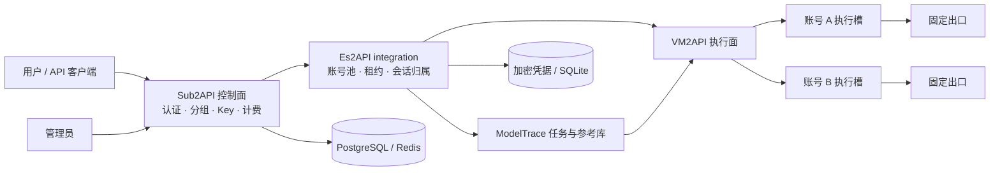

<p align="center"></p>

<h1 align="center">Es2API</h1>
<p align="center">VM2API 衍生分支 · Sub2API 控制台 · 隔离账号池 · ModelTrace · Linux 部署</p>

Es2API 将 **Sub2API 的用户、分组、Key、计费和管理界面**，与 **VM2API 的执行槽、容器、固定出口和协议执行面**连接起来，并在中间增加账号池、生命周期管理、会话隔离与模型检测控制台。

本项目是基于 [VM2API](https://github.com/dofastted/vm2api) 的衍生分支，同时包含 [Sub2API](https://github.com/Wei-Shaw/sub2api) 控制面。它不是上游官方版本，也不表示获得 OpenAI 或其他供应商背书。

> **许可说明**：本仓库公开源码，但整体不是 MIT 或无限制商用项目。VM2API 原许可限制商业用途，商用需向原权利人取得书面授权；Sub2API 部分沿用 LGPL-3.0。不同目录的许可见 [LICENSE](LICENSE) 和 [第三方来源](THIRD_PARTY_NOTICES.md)。

## 快速入口

- [下载 Linux x86_64 预览包](https://github.com/emstudio010-hub/Es2API/releases)
- [Linux 安装与运维](deploy-linux/README.md)
- [相对上游增加了什么](docs/FEATURES.md)
- [VM2API 分支、来源与架构](docs/UPSTREAM_AND_ARCHITECTURE.md)
- [ModelTrace 算法、调度与限制](docs/MODELTRACE.md)
- [一账号一工作区及自动 IP 分配](docs/ACCOUNT_WORKSPACES.md) · [真实 Codex CLI 后端（预览）](docs/CODEX_CLI_BACKEND.md)
- [OAuth 刷新、重试与重建交接](docs/CREDENTIAL_CONTINUITY.md) · [供应商身份去重与边界](docs/PROVIDER_IDENTITY.md) · [刷新日志与恢复](docs/REFRESH_RECOVERY.md)
- [变更记录](CHANGELOG.md) · [已知限制](docs/KNOWN_LIMITATIONS.md) · [源码构建](docs/BUILD.md)

## 增加了什么

| 方向 | Es2API 的新增与适配 |
| --- | --- |
| 账号池 | OAuth 管理与账号池分离；一个新 OAuth 一个工作区，独立实例、IP 与运行设置 |
| OAuth 导入 | JSON 导入和浏览器授权入口；同记录保留身份和期限，避免跨账号拼接；校验 state 后进入账号池 |
| 执行槽生命周期 | 创建、导入、健康确认、异步启动/停止/恢复；删除未确认时保留数据 |
| Codex CLI | 可选真实容器内 CLI 0.155.1，Responses/Chat 纯文本适配、单并发、请求级 HOME 与取消 |
| 固定出口 | 创建时自动独占分配空闲 IP 或手选出口，时区和身份随出口派生，绑定后固定 |
| 槽位归属 | 核对规范槽 ID、所属账号、创建代次；拒绝误绑定和删除其他账号槽位 |
| 用户调用 | 将账号池分组发布到原生 OpenAI 用户分组，复用用户 Key、余额、权限和计费 |
| 会话隔离 | 按用户 Key、分组、槽、账号实例及代次绑定；跨边界响应引用被拒绝 |
| 协议转发 | Responses、Chat Completions、SSE、Responses WebSocket；保留 priority/fast/ultrafast 字段 |
| ModelTrace | 指纹参考库、手动检测、后台任务、账号策略、检测历史、取消与动作防漂移 |
| 自动策略 | 按次数、定时、次数或时间、次数且时间、有调用才定时、概率、空闲后首调 |
| 运维 | 成功事件持久拉取、守护、私密备份/恢复和回滚工具；Linux systemd 启动 |
| 界面 | 鎏金主色、明暗模式、黑金 E 图标、账号池隔离详情和模型检测面板 |

实现细节和范围见 [功能说明](docs/FEATURES.md)。原生直连账号、VM2 独立入口与账号池入口有不同边界，不会因升级自动混合迁移。

## 架构



## Linux 安装

推荐 **Ubuntu 24.04 / Debian 12、x86_64、glibc 2.28+**。需要 Docker Engine 和 Compose v2，以及 bash、flock、iptables、iproute2、python3、CA 证书。发布包已内置 Node.js 和编译后的程序；第一次运行仍需联网拉取数据库和槽位镜像。

从 [Releases](https://github.com/emstudio010-hub/Es2API/releases) 下载 `.tar.gz` 及 `.sha256`，在服务器执行：

```bash
sha256sum -c Es2API-linux-x64-20261106-r28.tar.gz.sha256
tar -xzf Es2API-linux-x64-20261106-r28.tar.gz
cd Es2API-linux-x64-20261106-r28
sudo ./es2api.sh init
sudo ./es2api.sh run
```

默认管理入口：`http://127.0.0.1:18083`。远程服务器可以用 SSH 转发：

```bash
ssh -L 18083:127.0.0.1:18083 user@server
```

初始管理员为 `admin@es2api.local`，随机密码保存在服务器 `runtime/linux-secrets.json` 的 `admin.password`。发布包不含账号、代理、密钥或既有数据库。该文件还含加密主密钥，必须妥善备份。

后台自启：

```bash
sudo ./install-service.sh
sudo systemctl status es2api
sudo journalctl -u es2api -f
```

部署细节、对外监听、停止、数据库、升级和回滚见 [Linux 说明](deploy-linux/README.md)。不要把内部管理端口映射到公网。

## 第一次使用

1. 登录后由部署所有者审阅正常界面的合规承诺。
2. 在「执行 IP 资源」导入可用代理；从账号管理导入你有权使用的 ChatGPT OAuth，默认自动分配空闲 IP，可选 Kernel 或 Codex CLI 后端。
3. 等待账号槽位进入就绪状态，异常时查看账号错误和生命周期状态。
4. 进入对应账号池工作区，在发布入口选择原生 OpenAI 用户分组；实例操作完成后需在运行设置中手动启用调度。
5. 使用该原生分组的用户 Key；账号池负责执行槽租约，控制面保留原生权限和计费。
6. 在「模型智商控制台」检查 readiness，再自行保存检测策略。检测会产生真实供应商请求和用量。

发布分组、导入凭据和更改自动策略均需管理员操作；安装脚本不会自动完成这些业务操作。

公开版不内置上游 Google OAuth 客户端凭据。若使用额外的 Antigravity / Gemini CLI OAuth，需要自行配置对应客户端；见 [Google OAuth 配置](docs/GOOGLE_OAUTH.md)。ChatGPT 账号池的 OAuth 导入方式不因此改变。

## ModelTrace 不是 IQ 分数

界面沿用“模型智商控制台”名称，实际做的是参考候选集中的行为指纹归因。内置数据固定为 **60 个候选类、36 道挑战**，每轮选择 3 道不同挑战；不是模型真实身份、能力、质量或供应商真实性的保证。

支持自定义文本参考库，以及只观察、降权和暂停动作。`gpt-6.1-sol` 在当前固定库中映射到 `gpt-6-astra` 候选类，不能区分二者。检测失败不会自动重试供应商样本；参考库和完整方法见 [ModelTrace 文档](docs/MODELTRACE.md)。

## 项目状态

当前为 **预览版本**。最近完成的是源码实现、前端/Go 编译、Linux 打包与本机健康状态确认；按维护者要求，本次发布没有执行测试、Linux 部署、浏览器或真实供应商验收。

- 新增会话隔离、并发、SSE/WS、真实账号生命周期仍需独立验收。
- 历史 ModelTrace 第三样本出现的 502 尚未闭环，不能将检测功能描述为已完成生产验收。
- Docker 模式共享宿主内核；共用代理可能共用公网 IP，不等于独立虚拟机。
- HTTPS、域名和公网入口需要部署者自行配置；当前发布未提供完整生产上线保证。

详见 [已知限制](docs/KNOWN_LIMITATIONS.md)。

## 目录

```text
sub2api/           控制面、原生用户体系、Vue 管理台（含 Es2API 适配）
vm2api/            执行面、容器/槽、协议与辅助 React 控制台（含适配）
integration/       账号池、租约、加密持久化、ModelTrace、私有转发网关
deploy-linux/      Linux 分发启动器、systemd、数据库 Compose
deploy-local/      Windows + WSL 本地运行与运维工具
assets/brand/      Es2API 图标与生成说明
docs/              分支来源、功能差异、构建、检测与运行边界
licenses/          上游许可证与 Es2API 原创部分许可说明
```

## 分支与上游

本 GitHub 仓库保留 VM2API fork 关系，**`es2api` 分支**承载本项目整合布局，作为默认分支；`main` 保留 fork 时的上游历史，不是 Es2API 发布入口。控制面另基于 Sub2API 固定版本。具体提交记录在 [来源文档](docs/UPSTREAM_AND_ARCHITECTURE.md) 和 `rebuild-manifest.json`。

感谢 VM2API、Sub2API、CPA Codex Candy Eval、LM Detector 与各依赖项目的贡献者。贡献前请阅读 [CONTRIBUTING.md](CONTRIBUTING.md)，敏感问题见 [SECURITY.md](SECURITY.md)。
