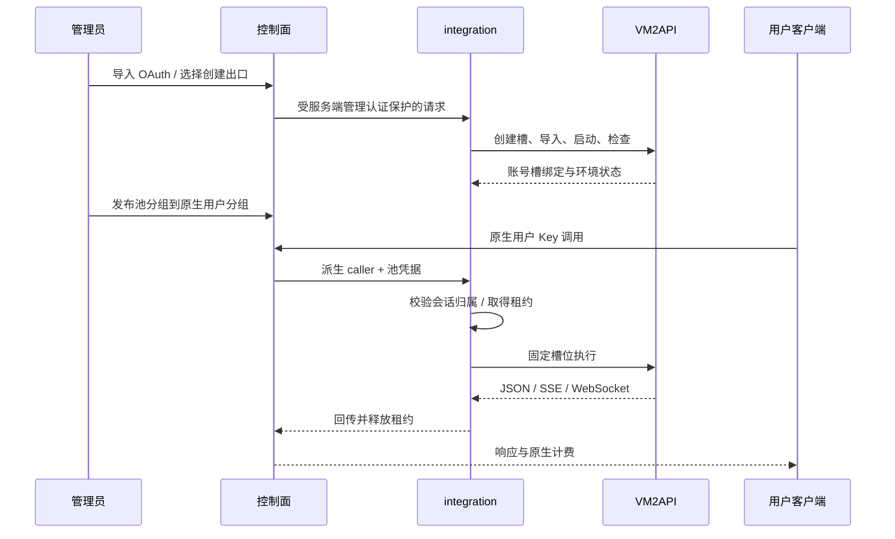

# VM2API 衍生分支与项目结构

## GitHub 分支

仓库以 `dofastted/vm2api` 的 GitHub fork 关系保留来源。

- `main`：fork 时的上游历史，仅用于来源追踪。
- **`es2api`**：本项目默认分支，整合 Sub2API、VM2API 和 Es2API integration。
- Releases：针对 Es2API 预览版本打标签，Linux 包不包含部署者数据。

`es2api` 分支采用多目录整合布局，与 VM2API 原根目录不同，因此不能直接用上游的一键覆盖升级替换该分支。辅助界面保留的上游更新/文档链接属于上游功能，使用 Es2API 时应按本项目发行说明更新。

## 固定基线

| 组件 | 仓库 | 起点 |
| --- | --- | --- |
| VM2API | https://github.com/dofastted/vm2api | `6f188e94e10ff6ce9239b4c39f964da4c98916d7` |
| Sub2API | https://github.com/Wei-Shaw/sub2api | `37067e8e340e9440d173a92b4faa05e8ce58368f` |

本分支在以上起点之上包含本地改动，不应把对应目录称为未修改的上游镜像。来源清单：`rebuild-manifest.json`。原始许可证分别保留。

## 服务职责

| 服务 | 职责 | 默认内部地址 |
| --- | --- | --- |
| 控制面 | 用户、Key、分组、余额、计费、管理前端、同源管理代理 | `127.0.0.1:18083` |
| integration | OAuth 凭据加密、账号池、租约、生命周期、检测、会话归属网关 | `127.0.0.1:18084` |
| VM2API | 槽管理、容器、固定环境、内核、供应商协议执行 | `127.0.0.1:18787` |
| PostgreSQL | 控制面业务数据 | `127.0.0.1:15433` |
| Redis | 控制面缓存/额度等运行数据 | `127.0.0.1:16380` |

这些端口是当前发行的约定，不代表上游默认端口。Linux 包默认入口也只监听回环；对外部署需另配入口。

## 账号进入与请求流

## 升级与上游同步

保留上游基线提交，分别审查 `sub2api/` 和 `vm2api/` 的上游变化，处理集成适配后再发布 Es2API 版本。不要直接在嵌套目录运行上游自更新覆盖本分支；本仓库嵌套目录是普通源码目录，不是 Git 子模块。

账号凭据、SQLite、PG/Redis 和执行槽数据必须与对应主密钥一起备份。程序升级前先停守护和应用。新会话归属索引不支持追溯升级前的 response/item ID，升级后使用新会话。
